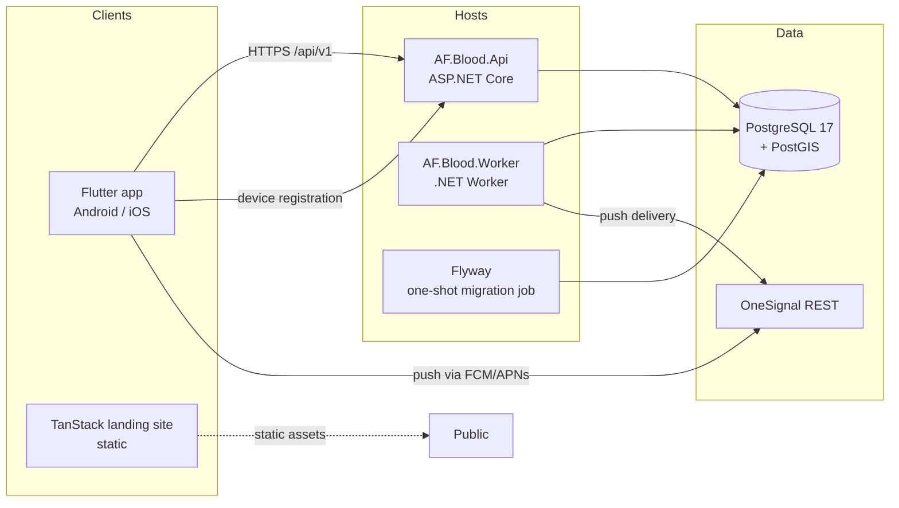
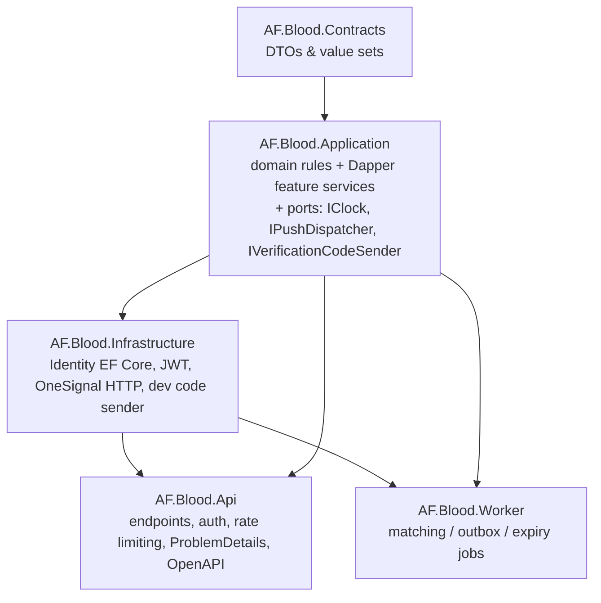

# Architecture overview

## Shape: modular monolith (ADR-0001)

One API executable, one Worker executable, one PostgreSQL database. Feature
boundaries are namespaces, not microservices.

## Layering

- **Contracts** — request/response records and reference value sets. No
  behaviour, no dependencies.
- **Application** — the heart. Pure domain rules
  (`Domain/BloodCompatibility`, `RequestStateMachine`, `DonationStateMachine`,
  `DeferralCalculator`, `WavePlanner`, `GeoGeneralizer`, `Backoff`) plus
  feature services that own explicit SQL via Dapper
  (ADR-0004: no repository layer). Services define their own transaction
  boundaries.
- **Infrastructure** — adapters only: ASP.NET Core Identity over EF Core
  (schema created by Flyway, ADR-0003), JWT issuance, refresh-token sessions,
  OneSignal HTTP client, dev verification-code sender.
- **Api / Worker** — thin hosts. The Api maps endpoints under `/api/v1`,
  wires auth/rate limiting/CORS/OpenAPI/health. The Worker runs three
  long-lived jobs on timers.

## Key flows

### Request → matching waves (ADR-0006)

1. `POST /api/v1/requests` commits the request **and** its wave-0
   `matching_runs` row in one transaction.
2. The Worker claims due runs with `FOR UPDATE SKIP LOCKED`, revalidates the
   request (open, unexpired), then selects candidates with a PostGIS query:
   discoverable + available + compatible group + `ST_DWithin(radius)` + no
   active deferral + not suspended + not already run/responded + not requester.
3. Membership (`matching_run_donors`) and notifications
   (`notification_history` + `notification_outbox`) are written in the same
   transaction; the wave is completed and the next wave scheduled only when
   the wave rules say so (ADR: few candidates → next radius, else stop).
4. The outbox job delivers notifications via OneSignal with bounded retries,
   jittered backoff, and lease recovery. Delivery is at-least-once.

### Acceptance (concurrency-safe)

`RespondAsync` locks the request row (`SELECT … FOR UPDATE`), revalidates
consent/availability/deferrals/suspension at accept time, inserts the response
(unique per donor/request), and takes the single donor slot
(`open → matched`). Two concurrent accepters → exactly one wins, the loser
gets 409.

### Donation reporting → deferrals

Donor reports → status `reported` (+ *provisional* restriction per approved
policy, if configured) → requester acknowledges (`completed_unverified`) or
disputes (`disputed`, request → `under_review`, admins notified) → verifier
confirms (`verified`, full policy deferral replaces the provisional one) or
rejects (provisional removed, request cancelled). Every change is appended to
`donation_record_events` and `audit_log`; nothing is silently overwritten.
Acceptance never starts a deferral.

## Technology choices (ADR index)

| ADR | Decision |
|-----|----------|
| [0001](adr/0001-modular-monolith.md) | Modular monolith, single DB, separate worker |
| [0002](adr/0002-authentication-design.md) | Identity + JWT access tokens + rotating refresh sessions |
| [0003](adr/0003-flyway-identity-schema.md) | Flyway owns schema; hand-written Identity SQL |
| [0004](adr/0004-dapper-application-services.md) | Application services own SQL via Dapper; no repos |
| [0005](adr/0005-location-privacy.md) | Location generalised at write time (~1 km) |
| [0006](adr/0006-outbox-and-worker-leasing.md) | Transactional outbox + SKIP LOCKED leasing; no broker |
| [0007](adr/0007-website-stack.md) | TanStack Router + Vite static site |
| [0008](adr/0008-testing-strategy.md) | Unit + real-PostgreSQL integration tests |

## Scale posture

Designed for ~10k users / ~1k donors nationwide (Pakistan) on one database
instance. The system intentionally excludes Redis, Kafka, Kubernetes, and
multi-region deployments. The leasing + outbox design tolerates multiple API
instances; the worker assumes a single instance per deployment (leases make
accidental double-processing safe but are not high-throughput coordination).
